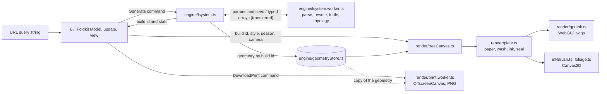

# Tree Garden

An L-system playground that paints plants as botanical ink plates. Pick a
grammar from *The Algorithmic Beauty of Plants* or write your own, watch it
grow, look at it under a loupe and print it at 300 dpi.

**Live:** https://reblws.github.io/tree-garden/

**How it works:** grammar → rewrite and turtle in a Web Worker → typed-array
branch segments → Canvas2D brush plus WebGL2 twigs → a plate of paper, ink,
leaves and a seal.

Built with [Foldkit](https://foldkit.dev) (the Elm architecture on
[Effect](https://effect.website)), Effect 4, TypeScript and Vite 8.

## Quick start

You need Node (CI uses 24) and pnpm 10 (the exact version is in
`packageManager` in `package.json`).

```sh
pnpm install
pnpm dev          # http://localhost:5173
```

| Command          | What it does |
| ---------------- | ------------ |
| `pnpm test`      | vitest: core, determinism against a frozen reference, the worker, the URL codec, camera, sheet, print, and Foldkit story tests |
| `pnpm typecheck` | `tsc --noEmit` |
| `pnpm build`     | typecheck, then a production build into `dist/` |
| `pnpm preview`   | serve the production build |

**Reproduce rendering bugs on `pnpm build && pnpm preview`** before you
chase them. The dev server differs: Foldkit's dev plugin restores the Model
across reloads, and the app regrows the plant when that happens
(`MissedGeometry`).

## What you can do

- **Pick a specimen.** 28 presets: the bracketed and stochastic plants of
  ABOP chapter 1, trees from Fractint, Paul Bourke and others, and classic
  fractals (Koch, Sierpinski, dragon, Gosper) for contrast. Each plate is
  inscribed with its source.
- **Edit the grammar.** Axiom, productions (one per line, `A (0.5) -> …` for
  a weighted random choice), iterations (0–12), angle δ, angle jitter and
  seed. Parse errors are listed by line. A build stops at 2M symbols.
- **Watch it grow.** Play, pause, replay or scrub. *Grow* extends every
  branch from the root at once, and the trunk thickens as the crown
  appears. *Trace* draws segments in the turtle's order.
- **Choose a plate style** (table below) and, for `Leaf`, a season or Auto.
  Auto chooses a seasonal wash or blossom from the seed. Like
  the camera, these are viewing choices and stay out of the link.
- **Zoom and pan** from the fitted view (100%) to 3200%. Scroll or pinch to
  zoom towards the pointer, drag or use two fingers to pan, and double-click
  or press **Fit** to go back. With the plate focused, `+`/`−` zoom by
  octaves, `0` fits and the arrow keys pan. Bark and stamens gain detail
  as you zoom in.
- **Share a link.** The query string holds the grammar, the numbers and the
  seed, so the same link grows the same plant.
- **Print A3** as a PNG at 300 dpi, always ink on paper, with a
  plate mark and pencilled inscriptions that include the seed. The same
  link, style, season and size give the same file, byte for byte.
- **Light or dark** switches with the icon in the top bar and remembers
  your choice. The first visit opens in dark mode.

| Style     | What it paints |
| --------- | -------------- |
| `Leaf`    | ink brush plus leaves in Spring, Summer or Autumn; Auto chooses a seasonal palette or plum blossom from the seed |
| `Ink`     | the ink brush alone |
| `Line`    | a plain technical pen in four weights (no ground, no seal) |

## Deployment

Every push to `main` runs the tests, builds with `--base=/tree-garden/` and
publishes `dist/` to GitHub Pages
([`.github/workflows/pages.yml`](.github/workflows/pages.yml)). A failing
test skips the deploy.

## Architecture

```
src/
  entry.ts       starts the generator's worker, then boots the Foldkit app
  core/          pure TypeScript, no Effect, no DOM; the hot loops live here
    geometry.ts    Segments2D: typed-array branch segments, shared by all 2D generators
    branching.ts   pipe-model radii, stroke chains, subtree ranges
    shading.ts     the lit cylinder that models bark
    lsystem/       grammar parsing, rewriting (compiled.ts), turtle
  params/        Effect Schema per algorithm (Model type, URL codec, slider ranges); presets
  engine/        Effect at the edges: seeded Random, the generator's worker,
                 GeometryStore (geometry and topology by build id)
  render/        <tree-canvas> (treeCanvas.ts), plate.ts, the painters, camera, sheet, print
  ui/            Foldkit app: model, messages, update, commands, subscriptions, view
  test/          determinism tests against a frozen reference copy of the old core
  styles.css     Tailwind, the full-height grid, the plate's CSS colours
```



### Rules of thumb

- **Geometry never enters the Foldkit Model.** The Model holds params, a
  build id and playback state. The geometry lives in
  `engine/geometryStore.ts`, and the canvas looks it up by id.
- **Pure core, Effect at the edges.** `core/` is plain TypeScript with no
  Effect and no DOM. `engine/build.ts` hands it a plain `() => number`
  backed by Effect's seeded `Random`.
- **Same link, same plant, byte for byte**, in the worker or inline. There is
  no `Math.random` in `core/` or `render/`; noise is hashed from chain
  indices and plate-space distance, so frames never flicker and marks don't
  swim. Every optimisation must be bit-identical: `src/test/determinism.test.ts`
  checks the generator and topology against `src/test/reference/`.
- **Marks are sized in plate units.** Painters draw in plate pixels under
  the view's transform, so zooming magnifies real marks (the trunk really
  gets wider). Only level-of-detail choices use screen pixels.
- **One sheet for screen and print.** `render/sheet.ts` sets the A-series
  proportions, margins and orientation for both: what you see is what you
  print.
- **Hot modules stay unbranded.** `vite.config.ts` skips Foldkit's
  `foldkit:view-identity` transform for `src/(core|render|engine)/`, which
  would otherwise cost about a third of generation time. Keep hot loops in
  those folders.

### Generation

`engine/lsystem.ts` runs each build (parse, rewrite, turtle, branch topology)
in `engine/lsystem.worker.ts`, which `entry.ts` starts before the app boots.
The typed arrays come back as transferables. A new request supersedes the
one in flight: its Effect fails with `Superseded` at once, and the worker
drops the old build at its next stage boundary (cheaper than respawning: a
fresh worker costs ~15–25 ms and runs its first big build ~1.5× slower).
Without `Worker` (vitest, happy-dom), or if it fails to load, the build runs
inline.

### Rendering

`core/branching.ts` turns the turtle's parent links into pipe-model radii
(`r_parent^2.3 = Σ r_child^2.3`) and stroke chains that follow the heaviest
child. `render/plate.ts`, shared by screen and print, places the plant and
stacks paper, colour wash, ink and seal. On screen the twigs go to WebGL2
(`render/gpuInk.ts`); without it, after a lost context and in the print they
are Canvas2D polylines (`render/collinearPen.ts`). `render/twigPlan.ts`
keeps both painters in agreement.

While the camera moves, cached pictures are stretched; ~130 ms after it
stops, the visible part is repainted crisp in 12 ms slices. The sheet turns
between portrait and landscape only at quiet moments (an edit committed, a
new plant or seed) and only at the fitted view. Prints are painted one at a
time in a module worker on OffscreenCanvas (`render/print.worker.ts`), with
a main-thread fallback that gives the same bytes.

**Read [docs/RENDERING.md](docs/RENDERING.md) before changing `src/render/`
or `src/core/branching.ts`.** It covers the invariants, the techniques
behind the look, what was tried and dropped, GPU parity, canvas pitfalls,
performance work and how to test the renderer.
[docs/ARCHITECTURE.md](docs/ARCHITECTURE.md) has the details of the sheet
and layout, print export, generation in the worker, and the zoom and pan
protocol.

### Performance

Headless Chrome, DPR 2, Apple M4, twigs on the GPU:

| Plant              | Playback | Finished plate (Ink / Leaf / Line) |
| ------------------ | -------- | ---------------------------------- |
| Twig n=11 (350K)   | ~58 fps  | ~70 / ~95 / ~10 ms                 |
| Weed n=8 (391K)    | ~52–55 fps | ~37 / ~47 / ~9 ms                |

Up to ~120K segments play at 60 fps. No long task runs on the main thread
before the first paint or during a print (A3 of Twig n=11, Leaf: ~1.2–1.6 s;
A2: ~2–2.5 s). The crisp repaint after a gesture lands ~200–350 ms later,
with no task over ~40 ms.

## Pinned versions

Foldkit is pre-1.0 and can break in minor releases, so `foldkit` and
`effect` are pinned to exact versions (0.170.0 and 4.1.1). Upgrade them
together, on purpose.

The interface uses locally bundled Instrument Sans (regular and italic),
with its Open Font License in `src/assets/fonts/OFL.txt`. On phones, the
⋯ button reveals the grammar editor, jitter, seed, Share and Print actions.
Hover over a control symbol for its explanation; About holds the credits
and zoom gestures.
